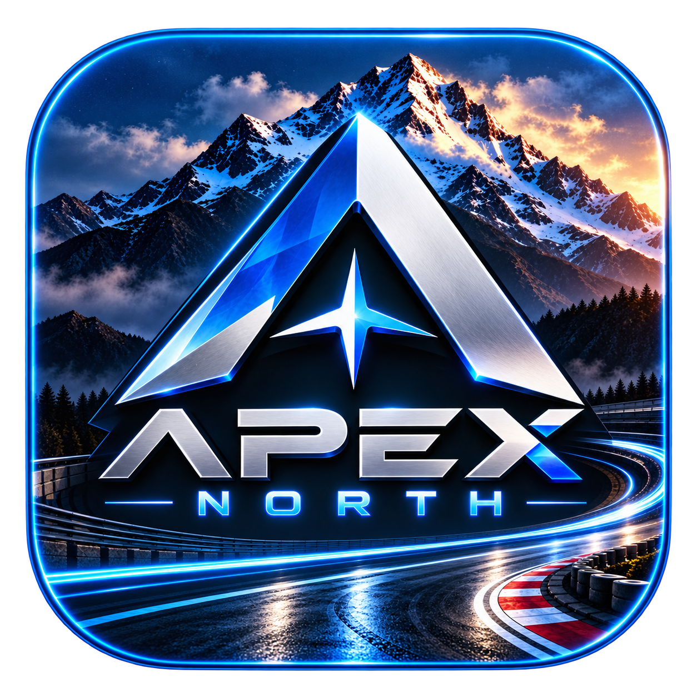
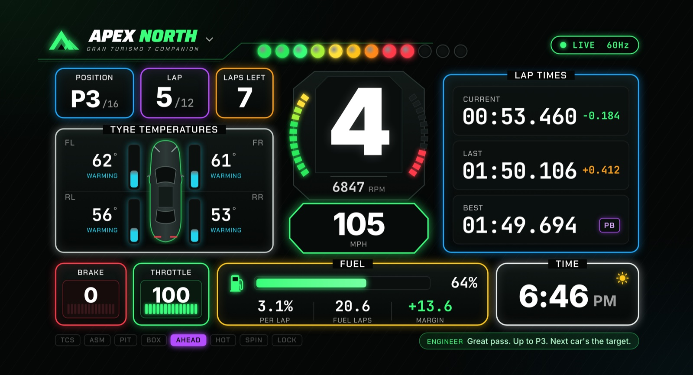
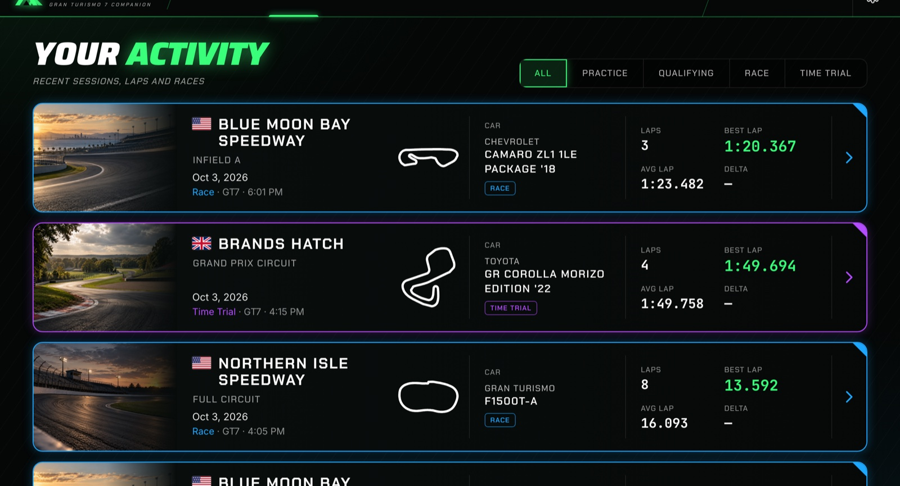
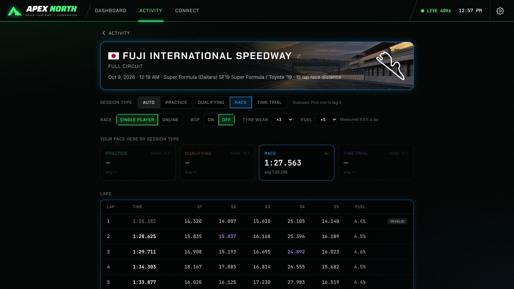
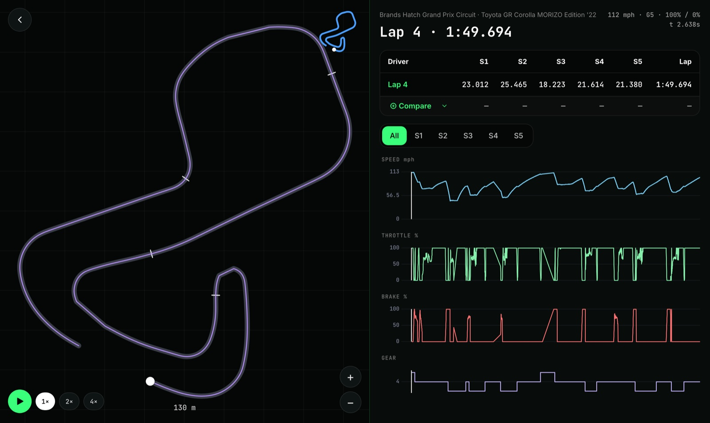

<p align="center">
  
</p>

<h1 align="center">ApexNorth</h1>

<p align="center">
  <b>A live telemetry dashboard and AI race engineer for Gran Turismo 7.</b><br/>
  No extra hardware. No account. Your data stays on your machine.
</p>

<p align="center">
  
  
  
  
  
  <a href="LICENSE"></a>
</p>

<p align="center">
  <a href="#install">Install</a> &middot;
  <a href="#features">Features</a> &middot;
  <a href="#connecting-to-your-playstation">Connect</a> &middot;
  <a href="#race-engineer-voice">Voice</a> &middot;
  <a href="#roadmap-phases--milestones">Roadmap</a> &middot;
  <a href="#development">Development</a> &middot;
  <a href="#license">License</a>
</p>

<p align="center">
  
</p>

## Overview

ApexNorth connects to your PlayStation over Wi-Fi and turns Gran Turismo 7's telemetry stream into a live dashboard, an automatic lap recorder and a race engineer that talks to you while you drive.

| | |
|---|---|
| **Drive** | A real-time dashboard with shift lights, live delta to your best lap, tyre temperatures, fuel and pit strategy. |
| **Record** | Every lap is saved at 30 Hz with five sector splits. Tracks and cars are named automatically. |
| **Analyse** | Replay any lap on a track map and compare it against your other laps in the same car, with synced speed, throttle, brake and gear traces. |
| **Listen** | A built-in offline voice engineer ([Kokoro](https://huggingface.co/hexgrad/Kokoro-82M) voices, nothing to install) calls lap times, sectors, fuel, the pit window, tyres and race position. |

The long-term goal is a race engineer you can talk to: an AI that reads your telemetry, tells you where you're losing time, and coaches you to get faster. See the [roadmap](#roadmap-phases--milestones).

## Screenshots

<table>
  <tr>
    <td width="50%"><br/><sub><b>Activity</b>: every session with its venue photo, flag, layout, car and lap stats, filtered by practice, qualifying, race or time trial</sub></td>
    <td width="50%"><br/><sub><b>Session</b>: tag the session type, note the race conditions, compare your pace by type, five sector splits per lap</sub></td>
  </tr>
  <tr>
    <td colspan="2"><br/><sub><b>Lap analysis</b>: racing line on the track map, playback, sector deltas against any other lap, and synced delta, speed, throttle, brake and gear traces</sub></td>
  </tr>
</table>

<sub>Screenshots show a real 15-lap race recorded from GT7 on a PS5: Fuji International Speedway in the Super Formula SF19.</sub>

---

## Install

ApexNorth is free. Pick **one** of these. Both get the same app, with the race engineer's voice built in.

### Option 1: one command (easiest)

**Mac:** open **Terminal** (press `⌘ Space`, type *Terminal*, press Enter), paste this line and press Enter:

```bash
curl -fsSL https://raw.githubusercontent.com/ElevenNorthCo/ApexNorth/main/install.sh | bash
```

**Windows:** open **PowerShell** (press the Windows key, type *PowerShell*, press Enter), paste this line and press Enter:

```powershell
irm https://raw.githubusercontent.com/ElevenNorthCo/ApexNorth/main/install.ps1 | iex
```

**Linux:** same as Mac, in a terminal.

It downloads the latest version, installs it and opens it. To update later, run the same line again.

### Option 2: download the installer

Go to the [**latest release**](https://github.com/ElevenNorthCo/ApexNorth/releases/latest) and download the file for your computer:

| Computer | File |
|---|---|
| Mac with Apple Silicon (M1, M2, M3, M4…) | `ApexNorth-macOS-AppleSilicon.dmg` |
| Mac with an Intel chip | `ApexNorth-macOS-Intel.dmg` |
| Windows 10 or 11 | `ApexNorth-Windows-Setup.exe` |
| Linux | `ApexNorth-Linux.AppImage` or `ApexNorth-Linux.deb` |

Not sure which Mac you have? Click the Apple menu → **About This Mac**. "Chip: Apple M…" means Apple Silicon. "Processor: Intel" means Intel.

- **Mac:** open the `.dmg` and drag **ApexNorth** into **Applications**. The first time you open it, macOS says it can't check the app, because ApexNorth isn't registered with Apple (that costs $99 a year). Open **System Settings → Privacy & Security**, scroll down and click **Open Anyway**. You only do this once. The one-command install skips this step.
- **Windows:** run the setup file. If a blue *Windows protected your PC* box appears, click **More info → Run anyway**.
- **Firewall:** the first time ApexNorth connects, Windows Firewall (or macOS) may ask to allow it on the network. Say **Allow**, or it can't hear your PlayStation.

### Updates

When a new version is out, an **Update** button appears in the top bar. Click it to open the download page, or run the install command again.

### Beta (test builds)

Want the newest features before they're released? The [**beta**](https://github.com/ElevenNorthCo/ApexNorth/releases/tag/beta-latest) always has the latest test build, with the same installers. It may have bugs. The Update button only ever offers regular releases, so you go back by installing the [latest release](https://github.com/ElevenNorthCo/ApexNorth/releases/latest).

### Then

Start GT7, get on track, and click **Find my PlayStation** in ApexNorth. No PlayStation handy? Choose **Try demo mode** on the Connect screen to watch a simulated race.

---

## Connecting to your PlayStation

1. Put your computer and your PS5/PS4 on the **same network**.
2. In GT7, get **on track**: a race, time trial, lobby or practice. The game doesn't send telemetry from menus.
3. In ApexNorth, open **Connect**, then choose **Find my PlayStation**.

If it can't find the console:
- Enter the IP manually. On the PS5 it's under *Settings → Network → View Connection Status*.
- Turn off **AP / client isolation** on your router, and avoid guest networks.
- **Windows:** allow ApexNorth through the firewall (UDP port **33740** inbound).
- **macOS:** allow *Local Network* access when prompted.
- Use 5 GHz Wi-Fi or Ethernet for the smoothest 60 Hz stream.

---

## Race engineer voice

The voice is built in: ApexNorth ships a voice engine ([sherpa-onnx](https://github.com/k2-fsa/sherpa-onnx), with ONNX Runtime and espeak-ng) and the **[Kokoro](https://huggingface.co/hexgrad/Kokoro-82M)** voices, natural-sounding and under the Apache-2.0 license, so callouts work straight after installing. Three are picked out: **Michael** (American male, the default), **Heart** (American female) and **George** (British male). Nineteen more English Kokoro voices are in the list too, American and British, no download needed.

It runs in a small helper program, `apexnorth-voice` (GPL-3.0, source in [`src-tauri/voice-helper`](src-tauri/voice-helper)), that keeps the voice loaded in memory: a new phrase takes a fraction of a second, repeated callouts play instantly from a cache, and if the voice engine ever crashes the app carries on and restarts it.

In **Settings → Race engineer voice**:
- **Voice:** pick any voice from the list.
- **Your own voices:** press **Open folder** and drop them into the app's `voices` folder, or choose a file with **Browse…**. Kokoro voice files (`.pt` as published on Hugging Face, `.npy`, or a raw 510×256 float32 `.bin`) are spoken by the bundled Kokoro model; a name starting `bf_`/`bm_` gets a British accent. Your own [Piper](https://github.com/rhasspy/piper) voice works too (`.onnx` with its `.onnx.json` next to it); check its license, as the published Piper voices are trained on noncommercial or research-only recordings, which is why ApexNorth no longer ships or offers them.
- Press **Test voice** to hear it.

If the voice can't play, the dashboard shows a red **Voice off** line explaining why.

---

## Features

### Live dashboard
- A neon ApexNorth layout, scaled to any window size.
- Live race position (P3 / 16), lap of total, and laps left.
- A large gear indicator with RPM arcs, suggested shift, and speed in km/h or mph.
- A 12-LED shift light bar driven by the car's own rev alert range. It flashes at the limiter.
- Current, last and best lap times, with a **live delta** to your best lap measured by distance.
- Tyre temperatures for all four corners around a top-down car, with temperature bars and cold / optimal / hot states.
- Brake and throttle readouts with fill bars.
- Fuel: a fill bar, % used per lap, laps of fuel left, finish margin, and pit window status.
- Status lights for TCS, ASM, pit window open, box now, ahead of best, hot tyres, wheelspin and lock-ups.
- A connection status readout (`SEARCHING`, `LIVE 60HZ`, `SIGNAL LOST`) and a clock.
- The screen stays awake while data is live.

### Simple connection
- A three-step wizard: get on track, find the PlayStation, connected.
- **Auto-discovery** finds the PS5/PS4 on your LAN. You can also enter the IP manually.
- The console's IP is remembered and reconnects automatically on launch.
- Supports all three GT7 packet formats (`A`, `B`, `~`) and falls back automatically for older game versions.
- **Demo mode** runs a built-in simulator so you can try the whole app with no PlayStation.

### Session recording & history
- Every lap is recorded automatically at 30 Hz and saved locally in SQLite.
- The Activity feed shows a card per session: track photo, country flag, venue and layout, track outline, car render with make and model, laps, best and average lap, and the delta to your previous best there.
- **Race conditions:** note how each session was run (single player or online, BoP on or off, tyre wear and fuel multipliers) from the Session page. They show as chips on the Activity card. GT7 doesn't send these, so you set them by hand; fuel use itself is always measured. A new race at the same track, car and distance starts with the last one's conditions, so you only change them when they change. Pace comparisons (the Activity delta and pace by type) only use sessions whose conditions match.
- **Session types:** tag a session as Practice, Qualifying, Race or Time Trial (or leave it on Auto). Filter the Activity feed by type, and see your best and average pace at that track by type, e.g. clean time-trial pace against race pace with traffic and tyre wear.
- Each Activity card shows a transparent render of the car you drove, centred above its make and model (574 cars, `src/assets/cars/`). A car newer than the bundled set just shows its name.
- Every one of the 41 GT7 venues has a preview photo (`src/assets/tracks/`, one per venue, shared by all its layouts). It shows on the Activity card and in the Session header. A session whose track wasn't recognised gets generated art from its outline.
- The lap table shows 5 sector splits, with the purple best lap and purple best sectors highlighted. It also shows fuel used per lap.
- **Pit detection:** a refuel or a stop flags the lap as a pit lap and keeps it out of best-lap records.
- Invalid laps (a rewind or reset, a lap you joined mid-way, or a race's opening lap from a grid that sits past the start line) are flagged and excluded.
- **Real track and car names.** GT7 doesn't send a track ID, so ApexNorth recognises the track from the line you drove. It checks the lap against a built-in catalog of all 121 GT7 layouts, including reverse layouts and chicane / no-chicane variants. Cars are named from the full GT7 car list (584 cars), e.g. "Porsche 911 GT3 RS (992) '22".
- A track the catalog can't place gets a placeholder name. Rename it from the session page, where the box suggests every GT7 track.

### Lap analysis & playback
- A track map showing the track surface, your racing line, sector markers and the car position, with zoom that follows the car and an overview mini-map.
- **Playback** animates the lap in real time at 1×, 2× or 4×.
- **Compare** against any lap with the same car on the same track, from any session (another car's lap isn't a fair reference). The laps are matched by position on track, so the ghost car runs at the other lap's real pace:
  - sector-by-sector deltas
  - a ghost line and ghost car on the map
  - overlaid traces
- Synced charts for delta, speed, throttle, brake and gear. Hover any chart to scrub the map.
- Sector filter (All, or S1–S5) zooms both the charts and the map.

### Race engineer voice
Callouts are spoken offline with the built-in Kokoro voices. The engineer follows the session in real time: sector by sector, through fuel and tyre strategy, to the flag.

Set your name in **Settings** and the engineer uses it ("Good luck out there, Michael.").

**Engineer chatter** sets how often it talks: *Minimal* (critical information only), *Normal*, *Chatty* or *Crew Chief*. **Callout categories** set what it talks about, and a category that's off stays off at every chatter level.

| Category | Example |
|---|---|
| Lap times | "1 34 point 7. Three tenths off your best." / "Purple lap! New personal best by four tenths." / "Final lap." |
| Sector coaching | "Sector one, two tenths up." / "Purple sector." / "You lost three tenths there." |
| Pace & encouragement | "Good pace. Keep it up." / "That's good consistency." / "Good recovery. You made most of that time back." |
| Fuel | "Fuel usage is 9.6 percent per lap. One stop expected." / "Fuel for about six laps." / "Fuel is critical." |
| Pit strategy | "Pit window laps 5 to 7. Lap 6 is the target." / "Fuel usage has increased. Target stop is now lap 5." / "Box this lap." |
| Tyres | "Rear tyres are getting hot." / "Front-left is running hotter than the others." / "Tyre performance is starting to drop." |
| Wheelspin & lock-ups | "Wheelspin on exit." / "You're consistently locking the fronts. Ease the brake pressure." |
| Incidents | "You've had a spin." / "Take it easy for the next couple of corners." |
| Race start | "Lights out. Go, go, go!" |
| Race position | "You start P5 of 16." / "Great start! Up one place to P4." / "Into a podium spot, P3!" / "Lost three places there, P5. Breathe, reset." / "Strong lap. Keep that up and you'll reel in P2." |

How it stays useful rather than noisy:
- **Anti-nag memory:** each fact is remembered when spoken. It isn't repeated unless it gets worse, changes, or enough time has passed.
- **Priorities:** box calls, critical fuel, overheating and spins speak immediately and clear queued chatter.
- **Context timing:** routine calls wait (briefly) for a straight, not mid-braking or mid-corner.
- **Phrase variation:** common calls rotate between equivalent wordings. Facts and numbers never change.

### Strategy engine
- **Fuel:** a rolling average that reacts quickly to a real change in consumption. Strategy switches off automatically when the game isn't burning fuel (time trials), so you never hear "hundreds of laps of fuel".
- **Pit window:** earliest, target and latest pit lap, plus the number of stops, from the current fuel, burn rate, full-tank range, laps remaining and a 0.3-lap reserve.
- **Tyre degradation (estimated):** GT7 sends no wear data, so ApexNorth reads the stint's lap-time trend, corrected for the car getting lighter as fuel burns. It reports *Fresh / Stable / Declining / Poor / Critical*, a loss per lap, a lap where pace is expected to drop off, and a confidence. It never claims a wear percentage.
- **Race conditions in the plan:** with tyre wear noted as off, the tyres never drive a stop; with fuel noted as off, there's no fuel plan from the first lap. With a wear multiplier noted, the fade you had at that track and car in earlier sessions (scaled to the multiplier) shapes the pit plan from lap 3, until the current stint's own trend is confident.
- **Combined plan:** when the tyre estimate is confident, it can bring the stop forward ("Fuel can make lap 7, but tyre degradation favors stopping on lap 6"). Otherwise fuel decides.

---

## How it works

```
PS5/PS4 ──UDP 33740──▶ telemetry/udp.rs   heartbeat + discovery + receive loop
                         │
                         ├─▶ crypto.rs     Salsa20 decrypt, packet-variant detection
                         ├─▶ packet.rs     parse into a typed Packet
                         ▼
                       session/engine.rs   lap detection, timing, delta, live sectors,
                         │                 lap validity, pit detection, G-forces
                         ├─ fuel.rs / tyres.rs / strategy.rs / incidents.rs
                         ├─▶ "telemetry" event (30 Hz) ─────▶ React dashboard
                         ├─▶ storage (SQLite + zstd lap blobs) ◀─ Activity / Lap Analysis
                         └─▶ engineer/rules.rs   what to say (structured calls)
                               └─ director.rs    chatter level, toggles, anti-nag, timing
                                    └─ voice.rs  apexnorth-voice helper (Kokoro) → WAV cache → rodio
```

- All the heavy work happens in Rust: decrypting, lap logic, recording and callouts. The UI only renders.
- **Lap timing:** GT7 sends no running lap time, so the current lap time comes from packet IDs (60 per second, so dropped packets are handled). The completed lap uses the game's official time, and the recorded samples are rescaled to match it.
- **Laps join at the line:** when the packets around the start/finish line have a gap, the lap is split there using the official lap time. Each lap starts at t = 0, d = 0 on the line, so laps line up cleanly for comparison.
- **Delta:** the elapsed time is compared with the reference lap's time at the same distance. The reference is your best lap in this session, or your stored best for this track and car.
- **Lap validity:** a lap is only thrown out on strong evidence. A single bad packet, a Wi-Fi dropout or a late packet is ignored. A position jump only counts once several packets agree the car really moved, and it's impossible over the real elapsed time. The reason is saved with the lap (hover *INVALID* in the session table).
- **Sectors:** five equal-distance sectors of the reference lap. Each one fires a live event with the sector time, the delta to the best sector and to the reference, and the running lap delta. A standing-start lap is never used as a sector benchmark.
- **Pit window:** the states are *No stop*, *Closed*, *Open* and *Box now*. The dashboard shows the window and target lap.
- **Storage:** data lives in your OS app-data folder (`apexnorth.db`). Settings live in the app config folder (`settings.json`).

---

## GT7 telemetry protocol

<details>
<summary>Packet format, cipher and handshake</summary>

Sources: Nenkai's PDTools, gt7telemetry, and the GTPlanet community.

| | |
|---|---|
| Heartbeat | Send `A`, `B` or `~` to `PS_IP:33739` about once a second |
| Receive | `0.0.0.0:33740`, about 60 packets/s |
| Cipher | Salsa20, key = the first 32 bytes of `Simulator Interface Packet GT7 ver 0.0` |
| Nonce | `iv1 = u32le @ 0x40`; `iv2 = iv1 ^ XOR`; nonce = `iv2 ‖ iv1` |
| XOR / size | `A` = `0xDEADBEAF` / 296 B · `B` = `0xDEADBEEF` / 316 B · `~` = `0x55FABB4F` / 344 B |
| Magic | `0x47375330` after decryption |

The field offsets are documented in [`src-tauri/src/telemetry/packet.rs`](src-tauri/src/telemetry/packet.rs).

</details>

---

## Project structure

<details>
<summary>Source layout</summary>

```
src-tauri/src/
  lib.rs                 app setup, live packet handler, Tauri commands
  settings.rs            settings, voice discovery
  voices.rs              Kokoro voice catalog (voices.json), voice files, the voice list
  telemetry/
    crypto.rs            Salsa20 encrypt/decrypt, packet variants
    packet.rs            GT7 packet parser (+ serializer for the simulator)
    udp.rs               link: heartbeats, LAN discovery, connection status
    sim.rs               demo-mode PlayStation simulator
  session/
    engine.rs            lap engine and live state
    fuel.rs              fuel model, fuel-off detection, pit window strategy
    tyres.rs             estimated tyre degradation
    strategy.rs          fuel + tyre pit plan
    incidents.rs         spin detection
    models.rs            Sample, CompletedLap, InvalidReason, sector math
  storage/mod.rs         SQLite: tracks, sessions, laps
  catalog/
    cars.rs              car code → name (data/gt7_cars.csv)
    tracks.rs            all GT7 layouts + recognising a lap's track (data/gt7_tracks.json)
  engineer/
    rules.rs             decision layer: events → candidate calls
    live.rs              tyre temperature and wheel-slip watchers
    director.rs          chatter level, toggles, anti-nag, context timing
    phrases.rs           phrase variation, spoken numbers
    voice_helper.rs      runs the apexnorth-voice helper and talks to it over a pipe
    voice.rs             synthesis, WAV cache, playback queue
src-tauri/voice-helper/  apexnorth-voice (GPL-3.0): sherpa-onnx + espeak-ng, Kokoro voice kept loaded
src/
  views/                 Connect, Dashboard, Activity, Session, LapAnalysis, Settings
  components/            Tile, TrackMap, TelemetryChart (uPlot), TrackOutline, Art, Flag, icons
  assets/                tracks/ (41 venue photos), cars/ (574 car renders)
  lib/                   api (typed commands), store (Zustand), format helpers
```

</details>

---

## Development

You need [Rust](https://rustup.rs) (stable), [Node.js](https://nodejs.org) 20+, Python 3, and the [Tauri prerequisites](https://tauri.app/start/prerequisites/) for your OS.

```bash
git clone https://github.com/ElevenNorthCo/ApexNorth.git
cd ApexNorth
npm install
python3 scripts/fetch-voice.py   # built-in voice: helper, engine, espeak-ng data, Kokoro (~400 MB, once)
npm run tauri dev                # app with hot reload
cd src-tauri && cargo test       # Rust unit tests
npx tsc --noEmit                 # type-check the frontend
npm run tauri build              # installer → src-tauri/target/release/bundle/
```

Without `fetch-voice.py` the app still runs, and falls back to a `piper` program on your `PATH` (`pipx install piper-tts`) for the voice.

### Releases

[GitHub Actions](.github/workflows/release.yml) builds the installers for macOS (Apple Silicon and Intel), Windows and Linux, with the built-in voice. Before building, it checks on each OS that the bundled voice actually speaks. To publish a release:

```bash
git tag v0.2.0 && git push origin v0.2.0
```

About 20 minutes later the installers are on the [Releases](https://github.com/ElevenNorthCo/ApexNorth/releases) page, the install commands pick them up, and everyone's app shows the **Update** button. No terminal needed: on GitHub, open **Actions → Release → Run workflow**, type the version (`v0.2.0`) and press **Run workflow**. Leave the version empty to only build the installers (they're attached to the run). A version with a dash (`v0.2.0-beta.1`) is published as a pre-release for testers; the update button and install commands skip pre-releases.

The tests cover:
- crypto round-trips for all three packet variants
- packet parsing
- lap engine timing, live sectors, and lap validity (spikes, dropouts, late packets, real resets)
- a full simulated race through the engine and engineer, at every chatter level
- SQLite storage
- car names, and track recognition for every layout with a reference line (forward, reverse, chicane variants, real PS5 captures)
- fuel strategy: fuel off, no stop, one stop, multi-stop, the window moving, box now
- tyre degradation, spin detection and the combined pit plan
- chatter levels, category toggles, cooldowns and priority
- spoken time formatting

**Demo mode** (Connect, then *Try demo mode*) starts a fake PlayStation on `127.0.0.1`. It answers heartbeats with encrypted packets from a 10-lap race simulation with a standing start, a speed profile, fuel burn, tyre wear and temperatures, wheelspin and lock-ups, a pit stop, and a spin on lap 8. This tests the full pipeline end to end.

---

## Roadmap: phases & milestones

<details>
<summary><b>Shipped: phases 1 to 3.8</b> (connect, record, voice engineer, strategy, new UI, car images)</summary>

### ✅ Phase 1: Connect & live data
- [x] Tauri 2 + React + TypeScript scaffold
- [x] GT7 Salsa20 decryption and packet parsing (A / B / ~), with unit tests
- [x] UDP link with heartbeat, auto-discovery (LAN sweep + broadcast) and variant fallback
- [x] Three-step connection wizard, remembered IP and auto-connect
- [x] Live dashboard (ApexNorth neon layout): gear, RPM, speed, shift lights, lap times, delta, tyres, fuel, inputs, clock
- [x] Demo mode simulator
- [x] **Milestone:** live data from a real PS5 at 60 Hz ✔

### ✅ Phase 2: Record, history & playback
- [x] Lap engine: official lap times, 30 Hz samples, 5 sectors, pit and invalid detection
- [x] SQLite storage, track fingerprinting, renamable tracks
- [x] Activity feed with track outlines
- [x] Session view with sector table and best laps/sectors highlighted
- [x] Lap analysis: track map, playback, compare against any lap, synced charts
- [x] **Milestone:** drive a session, then replay and compare laps ✔

### ✅ Phase 3: Piper race engineer
- [x] Offline Piper TTS with a WAV cache and priority queue
- [x] Callouts for lap times, PBs, final lap, fuel, pit window, tyres, wheelspin, lock-ups, race start and grid slot
- [x] Per-category toggles, volume, speaking speed, test button, and voice errors shown in the UI
- [x] **Milestone:** engineer callouts working live on track ✔

### ✅ Phase 3.5: Dynamic race engineer & strategy
- [x] Lap validity rebuilt: reasons per lap, no more real laps thrown out by a single bad packet or dropout
- [x] Live sector events and sector coaching with thresholds
- [x] Pace and encouragement backed by timing data
- [x] Chatter levels (Minimal / Normal / Chatty / Crew Chief) on top of per-category toggles
- [x] Severity-based wheelspin and lock-up calls
- [x] Spin detection from heading vs. direction of travel
- [x] Tyre temperature states, imbalance, rate of rise and post-incident recovery
- [x] Fuel strategy: rolling burn, stops required, earliest / target / latest pit lap, fuel-off detection
- [x] Estimated tyre degradation, combined with fuel for the pit plan
- [x] Context-aware timing, priorities, anti-nag memory and phrase variation
- [x] Late-lap "box this lap" reminder
- [x] Live race position: confirmed live on PS5. Places gained or lost are called once settled (pass and re-pass is one call), with podium, lead and start-specific lines, calm wording after a spin, and chase encouragement while holding a place
- [x] **Milestone:** a full live race where the engineer feels involved without being annoying ✔

### ✅ Phase 3.6: ApexNorth look & race position
- [x] New neon UI: dashboard, top toolbar, Activity cards, Session, Settings and Connect redesigned
- [x] Country flags; preview photos for all 41 venues on Activity cards and the Session header
- [x] Session types (Practice / Qualifying / Race / Time Trial) with filters and pace comparison per type
- [x] Race position callouts: gains, losses, lead, podium, start summary, chase encouragement

### ✅ Phase 3.7: Fixes & race conditions
- [x] Laps close at the start/finish line: a packet gap at the line is split using the official lap time, instead of leaving a hole and shifting the next lap's timing
- [x] Lap compare matches the reference lap by position, and the ghost car runs at the same lap time
- [x] Lap compare only offers laps with the same car on the same track
- [x] Grab a chart during playback to pause and scrub
- [x] Open-wheel car on the dashboard tyre panel
- [x] Activity delta: against your previous best at the track (same car first), or best vs. average on a first visit
- [x] Driver name in Settings, used by the engineer ("Good luck out there, Michael.")
- [x] Race conditions per session: single player or online, BoP, tyre wear and fuel multipliers (noted by hand; fuel use is measured)
- [x] Noted race conditions feed the strategy model: tyre wear off means no tyre stops or fade calls, fuel off means no fuel plan, and a noted wear multiplier uses the fade from your past sessions at that track and car until the current stint has its own trend. A new race at the same track, car and distance inherits the last one's conditions
- [x] Pace is compared only across matching conditions (BoP, tyre wear, fuel), on the Activity delta and the Session page's pace by type

### ✅ Phase 3.8: Car images
- [x] 574 transparent car renders on Activity cards, centred and sized up, mapped from the GT7 car code (`src/lib/carImages.json`)
- [x] Activity card layout rebalanced: the track outline sits beside the date so long names ("Fuji International Speedway") fit on one line, and the car image shrinks to make room for long car names and condition chips
- [x] Lap analysis legend no longer hidden behind the back button
- [x] A race's opening lap no longer counts when the grid sits past the line (Fuji): it's checked against the next full lap, and laps saved before the fix are repaired on launch

</details>

### 🔜 Phase 4: Polish & distribution
- [x] Piper voice engine built in (sherpa-onnx, loaded in-process) with the Ryan voice bundled: no Piper install, works straight after installing
- [x] Voice kept loaded in memory, so new callouts are near-instant (was about 2.5 s for an uncached phrase)
- [x] Four more voices (Alan, Northern English, Lessac, Amy) downloadable with one click in Settings
- [x] Kokoro voices built in (Apache-2.0) and the new default: Michael, Heart and George picked out, 19 more English voices in the list, and your own Kokoro voice files (`.pt`, `.npy`) from the voices folder
- [x] Ryan and the downloadable Piper voices removed: their training data is noncommercial or research-only. Only Kokoro ships now
- [x] **Test voice** plays the whole phrase (status updates while not connected used to cut it off)
- [x] Beta channel: the `beta` branch publishes a rolling test build ([beta-latest](https://github.com/ElevenNorthCo/ApexNorth/releases/tag/beta-latest)); merging to `main` with a new version publishes the release
- [x] GT7 car-name lookup (car code → "Porsche 911 GT3 (996) '01"), all 584 cars (verified live on PS5, 2026-10-03)
- [x] Built-in track database: all 121 layouts listed, 113 recognised automatically from the driven line (forward/reverse and chicane variants included), older sessions renamed on launch (verified live on PS5, 2026-10-03)
- [ ] Track database extras: real outlines and track-specific sectors
- [ ] Multiple dashboard layouts, plus speed/G-force/steering widgets
- [ ] Pre-race strategy briefing (fuel needed, planned stops)
- [x] GitHub Actions builds installers for macOS (Apple Silicon + Intel), Windows and Linux, with a voice test on each OS
- [x] One-line install commands (`install.sh`, `install.ps1`) and an in-app **Update** button when a new release is out
- [ ] Signed auto-update (download and install inside the app), and Apple/Windows code signing
- [x] App icon and branding

### 🔮 Phase 5: AI coach
- [ ] Lap analysis by Claude: compare against your best, find braking points, minimum corner speeds and throttle application
- [ ] A per-corner "where you lost time" report after each session
- [ ] Spoken coaching tips between laps
- [ ] Session summaries and progress tracking over time

### 🔮 Phase 6: Talk to your race engineer
- [ ] Push-to-talk voice input (speech-to-text)
- [ ] Chat with an engineer that knows your live telemetry and history ("How are my tyres?", "What do I need to do to beat my PB?")
- [ ] Engineer personalities and voices
- [ ] Optional Pitwall: multi-driver live view for leagues

---

## Known limitations
- **Tracks:** GT7 doesn't report a track ID, so tracks are recognised from the lap's line.
  - 8 of the 121 layouts have no reference line yet. Short layouts (Suzuka East, Nürburgring Sprint, Red Bull Ring Short Track, Autopolis Short Course) are matched by venue and length.
  - Barcelona Rallycross can't be recognised yet.
  - Nordschleife Tourist, Nürburgring Endurance II and Fuji (Short) drive the same line as their sister layouts, so they are named as those. Rename the track to fix that; the name sticks.
  - Anything unrecognised is named "Track N (x.xx km)" until you rename it.
- **Cars** that are newer than the bundled list show as `Car #<code>`, and about 10 of the newest have no image yet. Run `scripts/build_gt7_data.py` to refresh it.
- **Position:** race position comes from the packet's `pre_race_position` field, which updates live during races on PS5. GT7 sends no data on other cars, so there are no gaps to the car ahead or behind. A change must hold for about half a second (30 packets) before it counts, and about three seconds before it's announced (six in the opening 25 seconds).
- **Performance points (PP):** GT7 doesn't send PP or tuning data, so it can't be shown per session.
- **Tyre wear:** GT7 sends no tyre wear data. Degradation is estimated from the lap-time trend and stated with honest language, never as a percentage.
- **Pit entry:** track layouts differ and GT7 doesn't say where the pit lane is, so the "box this lap" reminder comes at about 75–90% of the lap.
- **Unsigned app:** ApexNorth isn't signed with an Apple or Microsoft certificate yet, so the first launch of a browser download needs **Open Anyway** (Mac) or **Run anyway** (Windows). The install commands avoid that.

---

## Credits
- Protocol research: [Nenkai/PDTools](https://github.com/Nenkai/PDTools), [Bornhall/gt7telemetry](https://github.com/Bornhall/gt7telemetry), and the [GTPlanet telemetry thread](https://www.gtplanet.net/forum/threads/overview-of-gt7-telemetry-software.418011/).
- Voice: [Kokoro-82M](https://huggingface.co/hexgrad/Kokoro-82M) (Apache-2.0), run with [sherpa-onnx](https://github.com/k2-fsa/sherpa-onnx) (Apache-2.0), [ONNX Runtime](https://github.com/microsoft/onnxruntime) (MIT) and [espeak-ng](https://github.com/espeak-ng/espeak-ng) (GPL-3.0).
- Car list: [ddm999/gt7info](https://github.com/ddm999/gt7info) (MIT-0).
- Track catalog and reference lines: [jbhoorasingh/gt7-datalogger-track-data](https://github.com/jbhoorasingh/gt7-datalogger-track-data) (CC0), built on captures from [zetetos/gt-telemetry](https://github.com/zetetos/gt-telemetry) (MIT). Test laps from [vthinsel/GT7Tracks](https://github.com/vthinsel/GT7Tracks) (MIT).

Not affiliated with Sony Interactive Entertainment or Polyphony Digital. Gran Turismo is a trademark of Sony Interactive Entertainment Inc. See [THIRD_PARTY_NOTICES.md](THIRD_PARTY_NOTICES.md) for everything ApexNorth includes and its licenses.

---

## License

ApexNorth is **free**, and the source is public. It's released under the [PolyForm Noncommercial License 1.0.0](LICENSE):

- ✅ Use it, share it, change it and build on it for personal, hobby, league, club, school or other **noncommercial** use.
- ❌ You may not sell it, charge for it, bundle it into a paid product or service, or otherwise use it to make money.
- 💬 Want to use it commercially? Contact Eleven North for a separate license.

Eleven North keeps all rights to offer ApexNorth, or features built on it, under other terms in the future.

The voice helper in [`src-tauri/voice-helper`](src-tauri/voice-helper) is a separate program under the **GPL-3.0-or-later**, because it uses espeak-ng. See [THIRD_PARTY_NOTICES.md](THIRD_PARTY_NOTICES.md).

**Contributing:** pull requests are welcome. See [CONTRIBUTING.md](CONTRIBUTING.md), including the short contribution license.

**Support the project:** if ApexNorth helps your racing, the **Sponsor** button at the top of this page is the best way to say thanks.

© 2026 Eleven North
